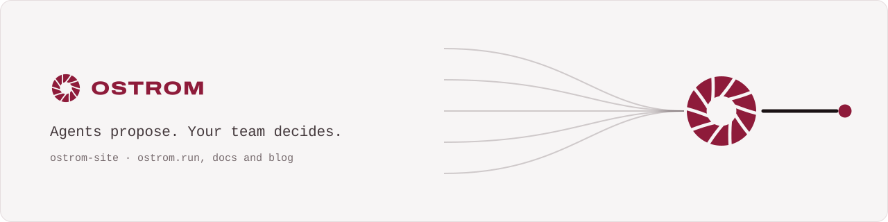
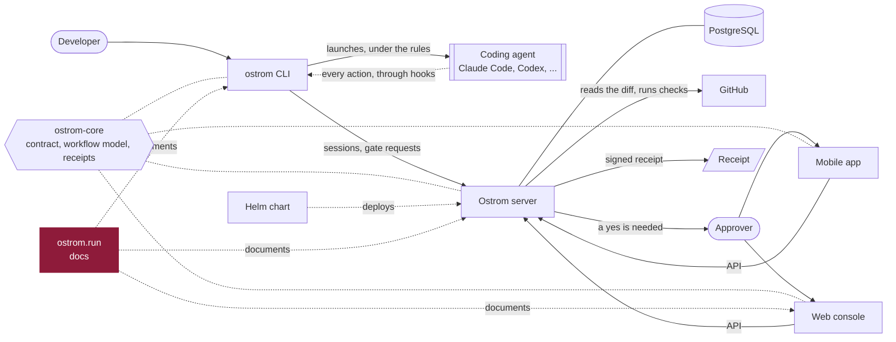

<p align="center">
  <a href="https://ostrom.run">
    <picture>
      <source media="(prefers-color-scheme: dark)" srcset=".github/assets/banner-dark.svg">
      
    </picture>
  </a>
</p>

<p align="center">
  <strong>Ostrom runs a company's AI coding agents in the cloud and makes them follow the team's rules.</strong><br>
  Every change they make leaves a receipt, and the few that matter wait for a person's yes.
</p>

<p align="center">
  <a href="https://ostrom.run">Website</a> ·
  <a href="https://ostrom.run/docs">Docs</a> ·
  <a href="https://github.com/ostrom-hq/ostrom-site/discussions">Discussions</a> ·
  <a href="CONTRIBUTING.md">Contributing</a> ·
  <a href="SECURITY.md">Security</a>
</p>

<p align="center">
  <a href="https://github.com/ostrom-hq/ostrom-site/actions/workflows/ci.yml"></a>
  <a href="CONTRIBUTING.md#tests-the-bar"></a>
  <a href="LICENSE"></a>
  <a href="CHANGELOG.md"></a>
</p>

## What this is

The public website of Ostrom, [ostrom.run](https://ostrom.run): the landing page, pricing, docs, blog, changelog,
security, open source and legal pages. Next.js (App Router) in strict TypeScript, exported as static files and served
by nginx from a container image. Nothing renders at request time.

## Quick start

```sh
git clone https://github.com/ostrom-hq/ostrom-site.git && cd ostrom-site
pnpm install
pnpm dev                 # http://localhost:3000
```

## How it fits



## Status

Ostrom is before its first public release. Until then the site is built with `NEXT_PUBLIC_LAUNCHED` unset: search
engines are asked not to index it and it links to no repository.

## Build and test

The steps of the single CI job `ci`, in order (`.github/workflows/ci.yml`; a draft pull request runs no CI):

```sh
pnpm install --frozen-lockfile
pnpm typecheck && pnpm lint && pnpm format:check   # types, lint, formatting
pnpm test:coverage                                 # Vitest, 100 % lines, branches, functions, statements
(cd docs-tools && npm ci && npm test && npm run lint:docs)  # the docs tooling and content
pnpm build && pnpm links                           # static export in out/, internal links and anchors
docker build -t ostrom-site .                      # the image Playwright and Lighthouse run against
PLAYWRIGHT_BASE_URL=http://localhost:8080 pnpm e2e # Playwright, desktop and mobile, axe WCAG 2.2 AA
pnpm exec lhci autorun --config=lighthouserc.cjs   # every page of the sitemap, 95 minimum per category
```

## Run locally

```sh
pnpm dev                 # http://localhost:3000, with hot reload
pnpm build && pnpm serve # the static export, served like nginx does
docker run -p 8080:8080 ghcr.io/ostrom-hq/ostrom-site:main
```

Build-time configuration (public URLs only, no secret): `NEXT_PUBLIC_SITE_URL` (default `https://ostrom.run`),
`NEXT_PUBLIC_APP_URL` (`https://app.ostrom.run`, where sign-up and sign-in live), `NEXT_PUBLIC_API_URL`
(`https://api.ostrom.run`), and `NEXT_PUBLIC_LAUNCHED`: unset until the public launch, the site asks search engines
not to index it (a `noindex` meta tag on every page and an `X-Robots-Tag` header from nginx on every file;
`robots.txt` stays open so crawlers can read them, and announces the sitemap only after the launch) and links to no repository;
`1` opens all of it.

## Performance

`pnpm build` ends with `scripts/defer-runtime.ts`: every exported page is complete HTML, and Next.js's runtime (about
150 kB compressed) starts after the first paint, at the first idle moment after `load` or at the first touch, key
press or focus. Until then the controls are plain HTML: a button pressed or a select changed in that moment is held and
played again once `<html data-runtime="ready">` marks that React runs the page. The end-to-end tests wait for that
mark (`e2e/test.ts`).

## Image

`main` publishes `ghcr.io/ostrom-hq/ostrom-site:<sha>` and `:main`: the exact image Playwright and Lighthouse tested.
It listens on port 8080 as an unprivileged user and answers `GET /healthz`. The same source built with
`NEXT_PUBLIC_LAUNCHED=1` is published as `:launched-<sha>` and `:launched`, for the day of the launch: Lighthouse
audits that build (on localhost URLs), and the published one passes a smoke test (health, indexable, repository
links) before it is pushed.

## Layout

- `src/app/`: the pages (App Router). `src/components/`: the components. `src/lib/`: logic, tested.
- `src/i18n/`: every text. English today; French later with the same keys. The marketing sentences are the locked value
  proposition, word for word.
- `src/styles/tokens.css`: the brand tokens (Signal, garnet `#8E1B3A`), copied from the brand system.
- `scripts/`: build tools (link checker, static server); their logic lives in `scripts/lib/` and is tested.
- `e2e/`: Playwright specs.

## Repositories

| Repository                                                  | What it is                                                                         | License       |
| ----------------------------------------------------------- | ---------------------------------------------------------------------------------- | ------------- |
| [ostrom-core](https://github.com/ostrom-hq/ostrom-core)     | Shared Kotlin Multiplatform library: API contract, workflow model, signed receipts | Apache-2.0    |
| [ostrom-cli](https://github.com/ostrom-hq/ostrom-cli)       | The `ostrom` command line: runs coding agents under the team's rules               | Apache-2.0    |
| [ostrom-server](https://github.com/ostrom-hq/ostrom-server) | The server: gates, receipts, policies, the API                                     | AGPL-3.0 + ee |
| [ostrom-web](https://github.com/ostrom-hq/ostrom-web)       | The web console                                                                    | AGPL-3.0 + ee |
| [ostrom-app](https://github.com/ostrom-hq/ostrom-app)       | The iOS and Android app                                                            | AGPL-3.0 + ee |
| [ostrom-e2e](https://github.com/ostrom-hq/ostrom-e2e)       | Full-stack end-to-end and load tests                                               | Apache-2.0    |
| **ostrom-site** (this one)                                  | ostrom.run: website, documentation, blog                                           | Apache-2.0    |
| [ostrom-helm](https://github.com/ostrom-hq/ostrom-helm)     | Helm chart and Docker Compose for self-hosting                                     | AGPL-3.0      |

## Contributing

Contributions are welcome. Read [CONTRIBUTING.md](CONTRIBUTING.md) (setup, tests, Conventional Commits, DCO), the
[Code of Conduct](CODE_OF_CONDUCT.md), and [SECURITY.md](SECURITY.md) to report a vulnerability privately. Questions
go to [Discussions](https://github.com/ostrom-hq/ostrom-site/discussions); help options are in [SUPPORT.md](SUPPORT.md).

## License

Apache License 2.0, see [LICENSE](LICENSE) and [NOTICE](NOTICE). You can use it in any project, open source or not.
